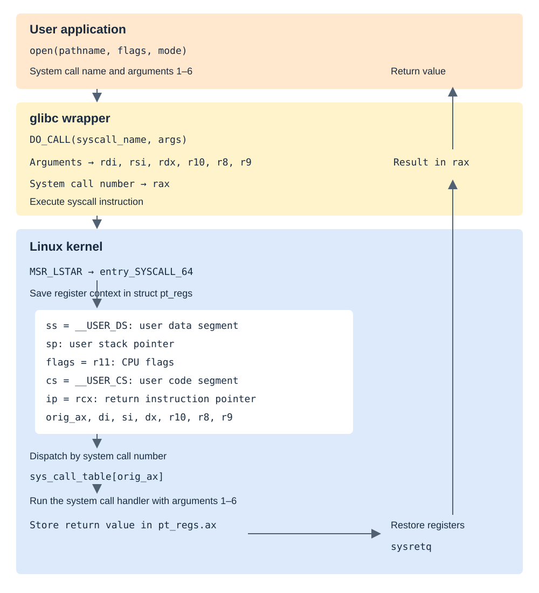

# Background

## Kernel data structures

Linux provides intrusive lists (`list_head`), red-black trees (`rb_root`, `rb_node`), hash lists (`hlist`), integer-to-pointer mappings (`idr`), and FIFOs (`kfifo`). Kernel helpers implement the structural operations; callers embed nodes in their own records and manage the surrounding data.

### Linked lists

Unlike `std::list<T>`, a kernel linked list embeds its links in the application record:

```c
struct list_head {
    struct list_head *next, *prev;
};

struct file_perm_list {
    struct list_head node;
    struct rb_root *root;
    fsid_t fsid;
};
```

The corresponding C++ container keeps its node implementation separate from the payload:

```cpp
struct file_perm {
    rb_root *root;
    fsid_t fsid;
};
std::list<file_perm> file_perm_list;
```

Kernel code uses `container_of` to recover the containing record from an embedded node. List helpers provide traversal, insertion, deletion, and access to the first element. Understanding this intrusive model makes other kernel structures easier to follow.

### Red-black trees

The kernel provides balancing and coloring helpers. Callers implement key comparison, lookup, insertion placement, and removal operations around those helpers. Aligned node pointers leave low address bits available for metadata, allowing parent pointers and node color to share a field:

```c
struct rb_node {
    unsigned long __rb_parent_color;
    struct rb_node *rb_right;
    struct rb_node *rb_left;
} __attribute__((aligned(sizeof(long))));

/* Mask the low bits to recover the parent pointer. */
#define rb_parent(r) ((struct rb_node *)((r)->__rb_parent_color & ~3))
/* The least significant bit records the color. */
#define __rb_color(pc) ((pc) & 1)
#define rb_color(rb) __rb_color((rb)->__rb_parent_color)
```

## System calls

The legacy interception backend replaces function pointers in `sys_call_table`. The table is write-protected; changing it requires architecture-specific handling. On x86, the CR0 write-protection bit is involved. The current backend also supports ftrace redirection to avoid modifying the syscall table on supported kernels.

[](images/syscall.svg)

- `open`: file read/write access and file creation within a parent directory.
- `unlink`: deletion.
- `rename`: renaming or moving.

Many `*at` variants accept a directory file descriptor and resolve relative paths against that directory. The special descriptor `AT_FDCWD` uses the calling task's current working directory.

## Filesystems

The protection implementation identifies files using filesystem and inode identifiers. Correct lifecycle handling is necessary because inode numbers can be reused.

## Scheduling

Wait queues let a task sleep until a condition changes or a timeout expires:

```c
static DECLARE_WAIT_QUEUE_HEAD(wq);

/* Task A waits for a decision. */
wait_event_timeout(wq, condition, timeout);

/* Task B wakes waiting tasks after updating the condition. */
wake_up(&wq);
```

During process protection, the task executing `execve` reports the operation and waits for a decision. A Generic Netlink handler receives the user-space decision and wakes that task. The condition must distinguish concurrent requests so that each task receives its own result.

## Kernel/user-space communication

Generic Netlink adds named families, commands, and typed attributes on top of Netlink. A kernel component registers a unique family name; user space resolves that name to communicate with the component. Keld uses the `KELD` family.

Commands select callbacks. Attributes carry typed data such as operation parameters and status codes. This avoids assigning a separate raw Netlink protocol number to every driver and provides a structured interface for requests, responses, and events.
